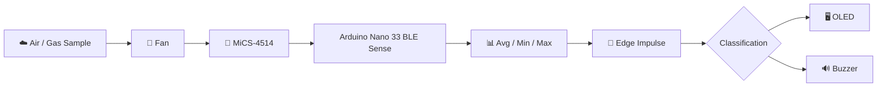
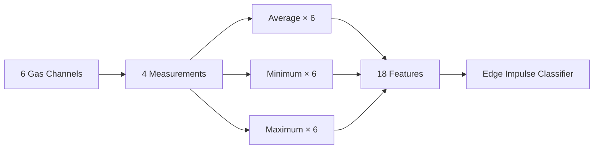
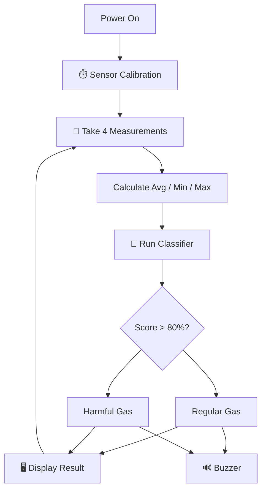

# ☁️ Bhopal 84

### Harmful gas pattern detection with Arduino, a gas sensor and TinyML

[](https://docs.arduino.cc/hardware/nano-33-ble-sense/)
[](https://www.edgeimpulse.com/)
[](https://www.dfrobot.com/product-2417.html)
[](LICENSE)

**Roni Bandini — Buenos Aires, Argentina — June 2022**

**Bhopal 84** is a TinyML gas-detection experiment that uses a single **[DFRobot MiCS-4514 multi-gas sensor](https://www.dfrobot.com/product-2417.html)** and an **[Arduino Nano 33 BLE Sense](https://docs.arduino.cc/hardware/nano-33-ble-sense/)** to recognize patterns in combinations of gas readings.

Instead of applying an independent threshold to each gas, the device calculates **minimum, maximum and average values** across several measurements and sends the resulting feature vector to an **[Edge Impulse](https://www.edgeimpulse.com/)** classifier.

The model distinguishes between:

```text
regular
harmful
```

and displays the classification confidence on a 128×32 OLED while providing an audible notification through a buzzer.

The project's name references the **[1984 Bhopal disaster](https://en.wikipedia.org/wiki/Bhopal_disaster)**.

---

## ✨ Features

* ☁️ Multi-gas sensing with a single MiCS-4514
* 🧠 TinyML classification on Arduino
* 📊 18-feature sensor vector
* 📈 Minimum, maximum and average calculations
* 🔬 Edge Impulse neural-network classifier
* 🖥️ 128×32 OLED interface
* 🔊 Buzzer notification
* 💨 Fan-assisted air sampling
* 📁 Training and testing CSV datasets included
* 🧱 3D-printable enclosure
* 🌐 Public Edge Impulse project

---

# 🏗️ Architecture



Everything from sensor acquisition to Machine Learning inference runs directly on the Arduino.

---

# 📡 MiCS-4514 Multi-Gas Sensor

The project uses the **[DFRobot Gravity MiCS-4514](https://www.dfrobot.com/product-2417.html)**.

It can provide measurements related to:

| Gas              | Symbol |
| ---------------- | ------ |
| Methane          | CH₄    |
| Ethanol          | C₂H₅OH |
| Hydrogen         | H₂     |
| Ammonia          | NH₃    |
| Carbon monoxide  | CO     |
| Nitrogen dioxide | NO₂    |

Official documentation:

👉 **[DFRobot MiCS-4514 Wiki](https://wiki.dfrobot.com/_SKU_SEN0377_Gravity__MEMS_Gas_Sensor_CO__Alcohol__NO2___NH3__I2C____MiCS_4514)**

The Arduino communicates with the sensor through I²C.

```cpp
DFRobot_MICS_I2C mics(&Wire, 0x75);
```

---

# 🧠 Feature Extraction

The current inference sketch reads six sensor channels:

```text
CO
CH4
C2H5OH
H2
NH3
NO2
```

For each channel, it calculates:

```text
Average
Minimum
Maximum
```

producing:

```text
6 gases × 3 statistics = 18 features
```

The resulting Edge Impulse feature array is:

```cpp
float features[18];
```

Conceptually:



This lets the classifier learn relationships between simultaneous sensor readings rather than treating each value separately.

---

# 📊 Data Acquisition

Training data is collected with:

👉 **[`gasAcquisition2.ino`](https://github.com/ronibandini/bhopal84/blob/main/gasAcquisition2.ino)**

Upload the acquisition sketch and open Arduino Serial Monitor.

The sketch repeatedly reads the MiCS-4514, calculates the statistical features and outputs CSV-compatible records.

The repository contains example datasets:

* 🟥 **[`harmful.csv`](https://github.com/ronibandini/bhopal84/blob/main/harmful.csv)**
* 🟥 **[`harmfultest.csv`](https://github.com/ronibandini/bhopal84/blob/main/harmfultest.csv)**
* 🟢 **[`regular.csv`](https://github.com/ronibandini/bhopal84/blob/main/regular.csv)**
* 🟢 **[`regulartest.csv`](https://github.com/ronibandini/bhopal84/blob/main/regulartest.csv)**

The data can then be imported into **[Edge Impulse Studio](https://studio.edgeimpulse.com/)**.

---

# 🧠 Edge Impulse Model

The original Machine Learning project is public:

👉 **[Bhopal 84 — Edge Impulse Project #114438](https://studio.edgeimpulse.com/public/114438/latest)**

The documented training configuration is:

| Parameter         |                Value |
| ----------------- | -------------------: |
| Window size       |          **1500 ms** |
| Processing block  |             Raw Data |
| Classes           | `regular`, `harmful` |
| Classifier        |                Keras |
| Training cycles   |               **60** |
| Learning rate     |           **0.0005** |
| Validation split  |              **20%** |
| Dataset balancing |              Enabled |
| Dropout           |              **0.1** |

The original experiment obtained approximately:

```text
harmful detection: 86%
regular detection: 96%
```

Complete model documentation:

👉 **[Harmful Gases Detection — Edge Impulse Expert Network](https://docs.edgeimpulse.com/projects/expert-network/harmful-gases-detection-arduino-nano-33)**

---

# 📦 Deploy to Arduino

After training the model in **[Edge Impulse Studio](https://studio.edgeimpulse.com/)**:

```text
Deployment
→ Arduino Library
→ Build
```

Download the generated ZIP.

In Arduino IDE:

```text
Sketch
→ Include Library
→ Add .ZIP Library
```

The inference firmware expects:

```cpp
#include <Bhopal84_inferencing.h>
```

Main application:

👉 **[`bhopal4.ino`](https://github.com/ronibandini/bhopal84/blob/main/bhopal4.ino)**

---

# ⚙️ Default Settings

Important values in `bhopal4.ino`:

```cpp
#define CALIBRATION_TIME 3
#define SCREEN_ADDRESS 0x3C
#define pinBuzzer 2

int measuresNumber = 4;
int measuresTimeFrame = 1500;

float scoreLimit = 0.80;
```

| Setting             | Purpose                       |     Default |
| ------------------- | ----------------------------- | ----------: |
| `CALIBRATION_TIME`  | Sensor warm-up/calibration    |   **3 min** |
| `SCREEN_ADDRESS`    | OLED I²C address              |      `0x3C` |
| `pinBuzzer`         | Buzzer output                 |      **D2** |
| `measuresNumber`    | Sensor readings per inference |       **4** |
| `measuresTimeFrame` | Measurement window            | **1500 ms** |
| `scoreLimit`        | Classification threshold      |    **0.80** |

Serial Monitor runs at:

```text
115200 baud
```

---

# 🔄 Inference Flow

At startup, the MiCS-4514 goes through its configured calibration period.

The program then continuously performs:



The OLED displays classification confidence such as:

```text
Harmful gas
92.4%
```

or:

```text
Regular gas
95.1%
```

---

# 🛠️ Hardware

| Component                                                                        | Function                |
| -------------------------------------------------------------------------------- | ----------------------- |
| [Arduino Nano 33 BLE Sense](https://docs.arduino.cc/hardware/nano-33-ble-sense/) | TinyML inference        |
| [DFRobot MiCS-4514](https://www.dfrobot.com/product-2417.html)                   | Multi-gas sensing       |
| 128×32 OLED                                                                      | Display                 |
| 5 V fan                                                                          | Moves air across sensor |
| Buzzer                                                                           | Audible output          |
| DC connector                                                                     | Power                   |
| 5 V supply                                                                       | System power            |
| [3D-printed enclosure](https://www.thingiverse.com/thing:5420469)                | Device body             |

---

# 🔌 Connections

### MiCS-4514

| MiCS-4514 | Arduino  |
| --------- | -------- |
| VCC       | 3.3 V    |
| GND       | GND      |
| SDA       | A4 / SDA |
| SCL       | A5 / SCL |

### OLED

| OLED | Arduino  |
| ---- | -------- |
| VCC  | 3.3 V    |
| GND  | GND      |
| SDA  | A4 / SDA |
| SCL  | A5 / SCL |

### Buzzer

```text
Signal → D2
GND    → GND
```

Detailed wiring:

👉 **[Bhopal 84 — Hackster.io](https://www.hackster.io/roni-bandini/bhopal-84-detect-harmful-gases-with-tinyml-c5ad84)**

---

# 📚 Arduino Libraries

The firmware uses:

```cpp
#include "DFRobot_MICS.h"
#include <Wire.h>
#include <Adafruit_GFX.h>
#include <Adafruit_SSD1306.h>
#include <Bhopal84_inferencing.h>
```

Resources:

* 📡 **[DFRobot MiCS Library and documentation](https://wiki.dfrobot.com/_SKU_SEN0377_Gravity__MEMS_Gas_Sensor_CO__Alcohol__NO2___NH3__I2C____MiCS_4514)**
* 🖥️ **[Adafruit SSD1306 Library](https://github.com/adafruit/Adafruit_SSD1306)**
* 🎨 **[Adafruit GFX Library](https://github.com/adafruit/Adafruit-GFX-Library)**
* 🧠 **[Edge Impulse Arduino deployment](https://docs.edgeimpulse.com/hardware/deployments/run-arduino)**

---

# 🚀 Installation

## 1. Install Arduino IDE

👉 **[Download Arduino IDE](https://www.arduino.cc/en/software)**

## 2. Clone the Repository

```bash
git clone https://github.com/ronibandini/bhopal84.git
cd bhopal84
```

Repository:

👉 **[github.com/ronibandini/bhopal84](https://github.com/ronibandini/bhopal84)**

## 3. Install Libraries

Install the MiCS-4514, SSD1306 and GFX libraries through Arduino IDE.

Then install the Arduino library exported from the public **[Edge Impulse model](https://studio.edgeimpulse.com/public/114438/latest)**.

## 4. Upload

For dataset generation:

👉 **[`gasAcquisition2.ino`](https://github.com/ronibandini/bhopal84/blob/main/gasAcquisition2.ino)**

For inference:

👉 **[`bhopal4.ino`](https://github.com/ronibandini/bhopal84/blob/main/bhopal4.ino)**

---

# 📁 Repository Structure

```text
bhopal84/
│
├── bhopal4.ino
├── gasAcquisition2.ino
│
├── harmful.csv
├── harmfultest.csv
├── regular.csv
├── regulartest.csv
├── headers.xlsx
│
├── README.md
└── LICENSE
```

* 🧠 **[`bhopal4.ino`](https://github.com/ronibandini/bhopal84/blob/main/bhopal4.ino)** — TinyML inference
* 📊 **[`gasAcquisition2.ino`](https://github.com/ronibandini/bhopal84/blob/main/gasAcquisition2.ino)** — dataset acquisition
* 📁 **[Training/testing data](https://github.com/ronibandini/bhopal84)** — sample CSV files
* ⚖️ **[`LICENSE`](https://github.com/ronibandini/bhopal84/blob/main/LICENSE)** — MIT License

---

# 🧱 3D-Printed Enclosure

The original enclosure and printable components are available on Thingiverse:

👉 **[Bhopal 84 — 3D Parts](https://www.thingiverse.com/thing:5420469)**

---

# 🎥 Demo

▶️ **[Bhopal 84 — TinyML Gas Detection Demo](https://www.youtube.com/watch?v=3ViArIxUhDY)**

---

# 🌐 External References

## 🧠 Edge Impulse

The official Edge Impulse Expert Network documentation covers data acquisition, feature generation, Keras training, Arduino deployment and operation.

👉 **[Harmful Gases Detection — Arduino Nano 33 BLE Sense](https://docs.edgeimpulse.com/projects/expert-network/harmful-gases-detection-arduino-nano-33)**

Public model:

👉 **[Bhopal 84 — Edge Impulse Studio](https://studio.edgeimpulse.com/public/114438/latest)**

---

## ♾️ Arduino Blog

Arduino featured the project in July 2022.

👉 **[Detecting harmful gases with a single sensor and tinyML — Arduino Blog](https://blog.arduino.cc/2022/07/11/detecting-harmful-gases-with-a-single-sensor-and-tinyml/)**

---

## 🛠️ Hackster.io

Complete build tutorial including parts, wiring, acquisition, model training and deployment.

👉 **[Bhopal 84, detect harmful gases with TinyML — Hackster.io](https://www.hackster.io/roni-bandini/bhopal-84-detect-harmful-gases-with-tinyml-c5ad84)**

---

## 🤖 DFRobot Maker Community

DFRobot published the project using its MiCS-4514 sensor.

👉 **[Detect harmful gases with Arduino and Machine Learning — DFRobot](https://community.dfrobot.com/makelog-312647.html/)**

---

## 🟣 PCBWay

The project is also published in PCBWay's shared projects collection.

👉 **[Bhopal 84 — PCBWay](https://www.pcbway.com/project/shareproject/Arduino/18.html?sort=view&tag=DIY)**

---

## 🎓 Academic Reference

A 2026 engineering thesis from Hochschule Mittweida explicitly cites the `bhopal84` project as inspiration for applying TinyML to gas differentiation.

👉 **[Bachelor thesis — Hochschule Mittweida PDF](https://monami.hs-mittweida.de/frontdoor/deliver/index/docId/15600/file/BA_59277_Hang-Yu.pdf)**

---

# 🔗 Related GitHub Projects

### 🏍️ TinyML Tire Care

Motorcycle motion classification with XIAO nRF52840 Sense and Edge Impulse.

👉 **[github.com/ronibandini/XIAOnRF52840TireCare](https://github.com/ronibandini/XIAOnRF52840TireCare)**

### 📡 Domestic ML LRAD

Human-action classification using Raspberry Pi, Edge Impulse and a Hugging Face dataset.

👉 **[github.com/ronibandini/domesticLMLRAD](https://github.com/ronibandini/domesticLMLRAD)**

### ⚽ Soccer Forecast

TinyML soccer-match forecasting on Arduino UNO R4 Minima.

👉 **[github.com/ronibandini/soccerForecast](https://github.com/ronibandini/soccerForecast)**

### 🚦 TI AM62A AI Traffic Light

Computer Vision and Edge Impulse running on Texas Instruments AM62A.

👉 **[github.com/ronibandini/TIAM62AITrafficLight](https://github.com/ronibandini/TIAM62AITrafficLight)**

---

# 📕 Contracultura Maker

**Contracultura Maker** is a book by Roni Bandini about maker culture, experimental electronics, AI, physical computing and technological autonomy.

📂 **[Contracultura Maker — GitHub repository](https://github.com/ronibandini/ContraculturaMaker)**

📕 **[Download Contracultura Maker PDF](https://github.com/ronibandini/ContraculturaMaker/raw/refs/heads/main/ContraculturaMaker2.pdf)**

---

# 📬 Contact

**Roni Bandini**
Maker · AI Developer · Writer
Buenos Aires, Argentina

* 🐙 [GitHub — @ronibandini](https://github.com/ronibandini)
* 🌐 [Medium — @ronibandini](https://bandini.medium.com/)
* 𝕏 [X / Twitter — @RoniBandini](https://x.com/RoniBandini)
* 📸 [Instagram — @ronibandini](https://www.instagram.com/ronibandini/)
* ▶️ [YouTube — @RoniBandini](https://www.youtube.com/@RoniBandini)
* 💼 [LinkedIn — Roni Bandini](https://www.linkedin.com/in/ronibandini/)

---

Built with ☁️ + Arduino + TinyML + Edge Impulse.
